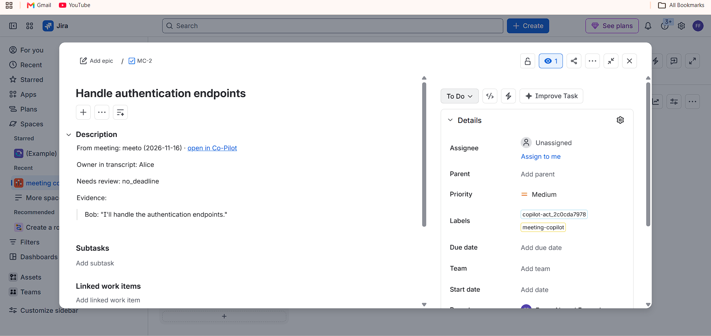
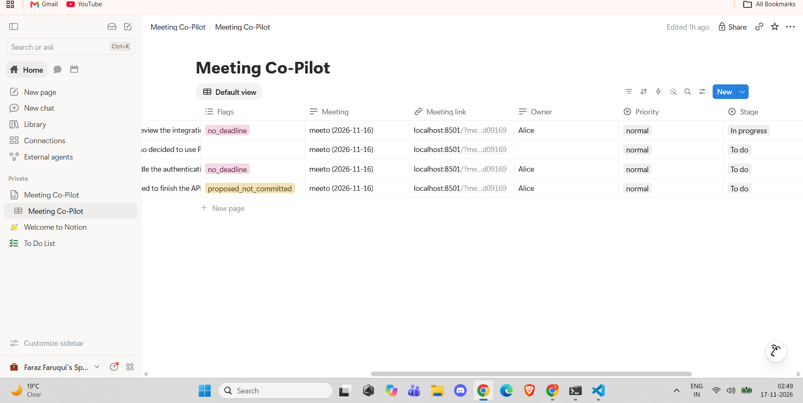

# meeting-copilot

## Replay Regression Test

Verified that the CI replay evaluation gate detects extraction regressions using recorded LLM responses.

For the test, I temporarily introduced an intentional fault in `src/copilot/eval/runner.py`:

```python
pred.actions = []
```

This caused all six replay meetings to produce zero actions.

The `eval-replay` CI job correctly failed on the following metrics:

- `act_f1`: 0.000 (required ≥ 0.558)
- `act_r`: 0.000 (required ≥ 0.970)
- `act_full_recall`: 0.000 (required ≥ 0.970)

The regression was tested on a temporary scratch branch and was not merged.

### CI failure evidence


## Notion and Jira Integration

Live integration testing completed with Notion and Jira Cloud.

- Created 4 Notion pages and 3 Jira issues.
- Repeated pushes correctly returned `unchanged` without creating duplicates.
- Owner changes updated existing records.
- Deleted Notion pages were recreated on a forced sync.
- Manually updated Notion Stage values were preserved during sync.

### Notion setup

The integration creates a database using Notion's Select properties.

`Stage` is intentionally implemented as a Select property rather than Notion's built-in Status property because the setup API creates Select properties. Stage is human-managed and is not overwritten during copilot updates.

### Screenshots

| Test | Screenshot |
|---|---|
| Initial push |  |
| Idempotent push |  |
| Owner update |  |
| Deleted page recovery |  |
| Stage preservation |  |
