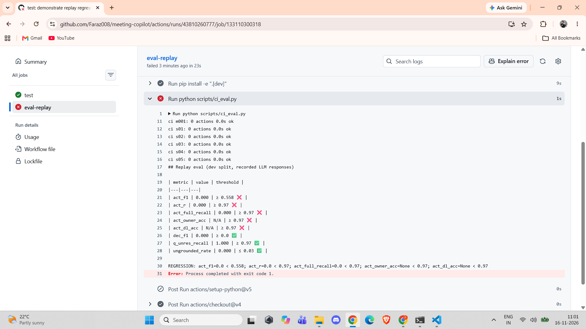
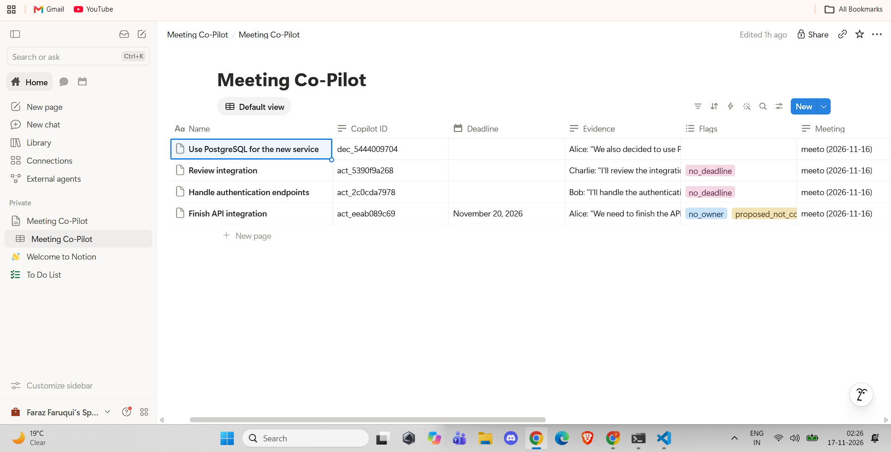
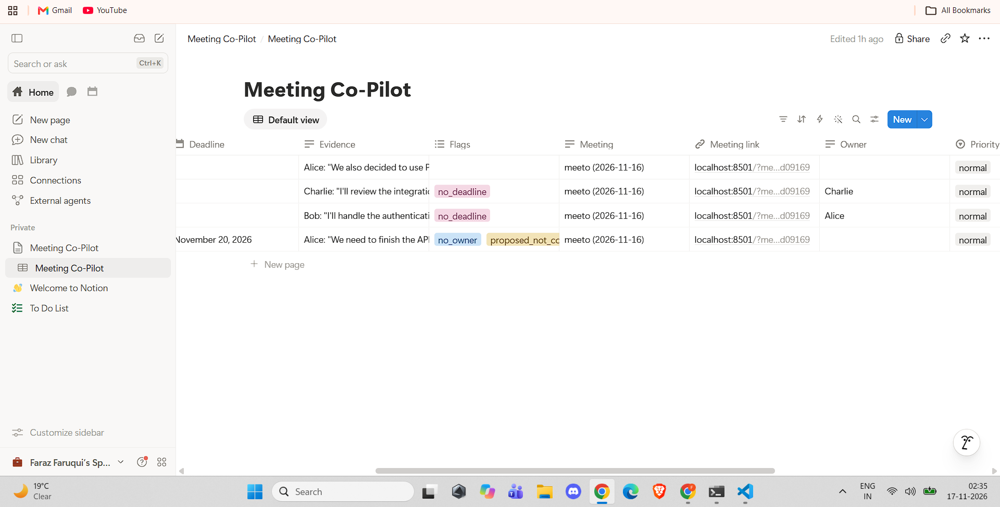

# meeting-copilot

## Replay Regression Test

Verified that the CI replay evaluation gate detects extraction regressions using recorded LLM responses.

For the test, I temporarily introduced an intentional fault in `src/copilot/eval/runner.py`:

```python
pred.actions = []
```

This caused all six replay meetings to produce zero actions.

The `eval-replay` CI job correctly failed on the following metrics:

- `act_f1`: 0.000 (required ≥ 0.558)
- `act_r`: 0.000 (required ≥ 0.970)
- `act_full_recall`: 0.000 (required ≥ 0.970)

The regression was tested on a temporary scratch branch and was not merged. The frozen evaluation code was not changed for the final evaluation.

### CI failure evidence



## Notion and Jira Integration

Live integration testing completed with Notion and Jira Cloud.

- Created 4 Notion pages and 3 Jira issues.
- Repeated pushes correctly returned `unchanged` without creating duplicates.
- Owner changes updated existing records.
- Deleted Notion pages were recreated on a forced sync.
- Manually updated Notion Stage values were preserved during sync.

### Notion setup

The integration creates a database using Notion's Select properties.

`Stage` is intentionally implemented as a Select property rather than Notion's built-in Status property because the setup API creates Select properties. Stage is human-managed and is not overwritten during copilot updates.

### Screenshots

| Test | Screenshot |
|---|---|
| Initial push |  |
| Idempotent push |  |
| Owner update |  |
| Deleted page recovery |  |
| Stage preservation |  |

## Privacy and PII Redaction

The pipeline includes identifier-level PII redaction in `src/copilot/privacy/pii.py`.

It redacts:

- Email addresses and phone numbers
- Card numbers
- Aadhaar-like and PAN numbers
- URLs and IP addresses
- API keys and other key-shaped strings

**Limitation:** Person names are intentionally not redacted because the pipeline needs them for action-item owner resolution. This is identifier redaction, not complete personal-data anonymization.


## Final Evaluation

Evaluated the frozen pipeline (`v0.9.1-frozen`) on 10 held-out meetings (`s06`–`s15`), containing 23 gold action items.

The evaluation compared a baseline against the full pipeline across Groq, OpenRouter and Ollama. Action F1 is micro-averaged using the title matcher.

### Baseline vs full pipeline

| Provider | Baseline Action F1 | Full Action F1 | Full pipeline completion |
|---|---:|---:|---:|
| Groq | 72% | 68% | 10/10 |
| OpenRouter | 65% | 23% | 5/10 |
| Ollama | 68%* | 68% | 10/10 |

*Ollama's baseline had one schema failure (`s14`), so its baseline score is based on 9/10 completed meetings.*

**Execution notes**

- **Groq:** All five evaluated systems completed across the 10 meetings.
- **OpenRouter:** The full pipeline had incomplete predictions for `s07`, `s12`, `s13`, `s14` and `s15`.
- **Ollama:** The full pipeline and its ablations completed across all 10 meetings. The baseline failed on `s14`.

The runner's `--resume` option skips existing prediction files, including incomplete or failed ones. These predictions were retained rather than silently regenerated.

### Detailed results

See the provider-specific reports for confidence intervals, precision and recall, owner and deadline accuracy, decision extraction, ablation comparisons and dev-vs-test results.

- [Groq results](docs/results_final_groq.md)
- [OpenRouter results](docs/results_final_openrouter.md)
- [Ollama results](docs/results_final_ollama.md)

### Predictions vs. observed results

The following compares the expected failure modes recorded before the held-out evaluation with the observed results.

| Pre-evaluation expectation | Observed result | Assessment |
|---|---|---|
| Action precision would be a weakness. | Full-pipeline precision was 52% for Groq, 19% for OpenRouter and 54% for Ollama, compared with respective recalls of 96%, 30% and 91%. | **Hit** |
| Decision extraction would remain weak. | Decision F1 was 40% for Groq and 8% for OpenRouter, but 62% for Ollama. | **Partial hit** |
| Deadline interpretation and normalization could cause errors. | Removing code-assisted date handling reduced fully-correct action recall and deadline accuracy for Groq and Ollama. | **Hit** |
| Evidence grounding would help control unsupported output. | Ollama's ungrounded output increased from 0% to 3% without grounding, although Action F1 remained unchanged. | **Partial hit** |
| Ambiguous ownership and evidence would remain challenging. | Owner accuracy was relatively high in the completed Groq and Ollama full runs. The aggregate metrics do not isolate ambiguity as a cause of errors. | **Inconclusive** |

**Additional observations**

- The full pipeline did not consistently improve headline Action F1 over the baseline.
- Ollama achieved the strongest full-pipeline Decision F1 (62%), but also produced 7 spurious actions per negative meeting.
- OpenRouter's incomplete predictions prevent a reliable full-split comparison.
- The no-pass2 ablation had little effect on headline Action F1 for the completed Groq and Ollama runs.

## Limitations

- [Limitations](docs/limitations.md)
