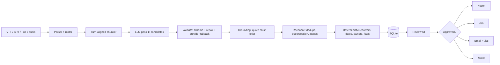
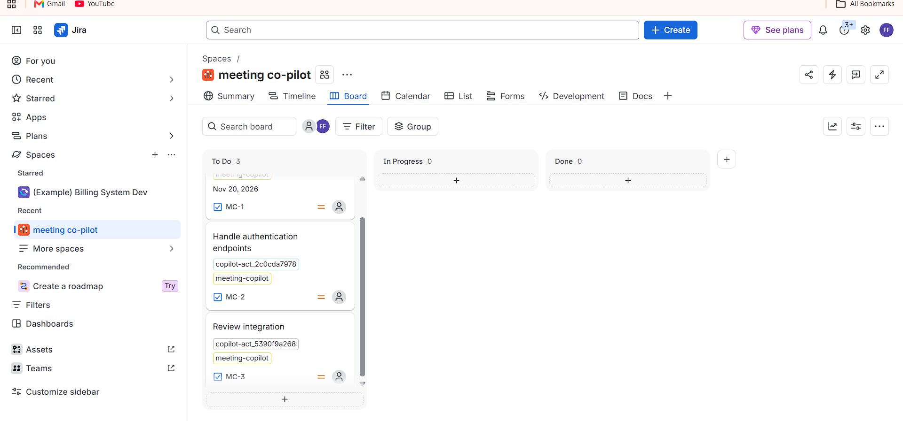

# Meeting Co-Pilot

Turn messy meeting transcripts into **reviewed, evidence-backed** decisions, action items, owners, deadlines and open questions, then push the approved ones to Notion, Jira, email, calendar and Slack.

Free stack. Built to be **trustworthy, not just plausible**.

[Design write-up](docs/design.md) · [Results](docs/result.md) · [Limitations](docs/limitations.md)

[](https://github.com/Faraz008/meeting-copilot/actions/workflows/ci.yml)

---

## Why this is different

Most "meeting → tasks" demos are one prompt and a JSON blob. This one treats the LLM as an unreliable component and puts engineering around it:

- **Every item cites verbatim evidence** — checked against the transcript. Fabricated quotes are rejected.
- **Dates and owners are resolved by deterministic code, not the model** — unresolvable cases are flagged, never guessed.
- **Retractions and revisions** ("scratch that, Dan will do it") are tracked, not duplicated.
- **Unowned tasks, unresolved questions and ambiguous deadlines** are surfaced for a human.
- **Idempotent pushes** — re-running updates instead of duplicating; humans own workflow fields.
- **Measured** — labeled benchmark, ablations, bootstrap confidence intervals and a CI gate that fails on regression.

## Results

### Held-out evaluation

Evaluated the frozen pipeline (`v0.9.1-frozen`) on held-out meetings containing gold action items.

Action F1 is micro-averaged using the title matcher.

<!-- RESULTS:START -->

### Baseline vs pipeline: held-out test, ollama

Matcher: **title**. Values are micro-averaged over 10 meetings; brackets are 95% bootstrap CIs over meetings.

| system | Action F1 | Action precision | Action recall | Fully-correct actions (recall) | Owner accuracy | Deadline accuracy | Decision F1 | Unresolved-question recall | Ungrounded items in output | Spurious actions / negative meeting |
|---|---|---|---|---|---|---|---|---|---|---|
| baseline | 68% [53%–82%] | 63% [48%–87%] | 74% [48%–100%] | 52% [21%–89%] | 94% [79%–100%] | 82% [59%–100%] | 20% [6%–38%] | 100% [100%–100%] | – | 0.0 [0.0–0.0] |
| full | 68% [48%–85%] | 54% [33%–77%] | 91% [71%–100%] | 65% [39%–88%] | 95% [82%–100%] | 81% [56%–100%] | 62% [20%–88%] | 100% [100%–100%] | 0% [0%–0%] | 7.0 [7.0–7.0] |
| no_grounding | 68% [48%–85%] | 54% [33%–77%] | 91% [71%–100%] | 65% [39%–88%] | 95% [82%–100%] | 81% [56%–100%] | 62% [20%–88%] | 100% [100%–100%] | 3% [0%–7%] | 7.0 [7.0–7.0] |
| no_code_dates | 68% [48%–85%] | 54% [33%–77%] | 91% [71%–100%] | 61% [29%–88%] | 95% [82%–100%] | 76% [43%–100%] | 62% [20%–88%] | 100% [100%–100%] | 0% [0%–0%] | 7.0 [7.0–7.0] |
| no_pass2 | 67% [47%–84%] | 52% [33%–77%] | 91% [71%–100%] | 65% [39%–88%] | 95% [82%–100%] | 81% [56%–100%] | 62% [20%–88%] | 100% [100%–100%] | 0% [0%–0%] | 7.0 [7.0–7.0] |

### Difference vs `baseline` (paired bootstrap; if the interval includes 0, treat as noise)

| system | Action F1 | Action precision | Action recall | Fully-correct actions (recall) | Owner accuracy | Deadline accuracy | Decision F1 | Unresolved-question recall | Ungrounded items in output | Spurious actions / negative meeting |
|---|---|---|---|---|---|---|---|---|---|---|
| full | -0.3 [-23.3, +20.5] | -9.1 [-33.7, +8.2] | +17.4 [+0.0, +42.9] | +13.0 [-35.3, +58.6] | +1.1 [-13.6, +20.0] | -1.4 [-33.3, +30.0] | +41.5 [+13.3, +57.9] | +0.0 [+0.0, +0.0] | – | +7.0 [+7.0, +7.0] |
| no_grounding | -0.3 [-23.3, +20.5] | -9.1 [-33.7, +8.2] | +17.4 [+0.0, +42.9] | +13.0 [-35.3, +58.6] | +1.1 [-13.6, +20.0] | -1.4 [-33.3, +30.0] | +41.5 [+13.3, +57.9] | +0.0 [+0.0, +0.0] | – | +7.0 [+7.0, +7.0] |
| no_code_dates | -0.3 [-23.3, +20.5] | -9.1 [-33.7, +8.2] | +17.4 [+0.0, +42.9] | +8.7 [-45.8, +57.9] | +1.1 [-13.6, +20.0] | -6.2 [-46.2, +30.0] | +41.5 [+13.3, +57.9] | +0.0 [+0.0, +0.0] | – | +7.0 [+7.0, +7.0] |
| no_pass2 | -1.3 [-24.6, +19.0] | -10.5 [-34.2, +6.3] | +17.4 [+0.0, +42.9] | +13.0 [-35.3, +58.6] | +1.1 [-13.6, +20.0] | -1.4 [-33.3, +30.0] | +41.5 [+13.3, +57.9] | +0.0 [+0.0, +0.0] | – | +7.0 [+7.0, +7.0] |

### Ablations: held-out test, ollama

Matcher: **turns**. Values are micro-averaged over 10 meetings; brackets are 95% bootstrap CIs over meetings.

| system | Action F1 | Action precision | Action recall | Fully-correct actions (recall) | Owner accuracy | Deadline accuracy | Decision F1 | Unresolved-question recall | Ungrounded items in output | Spurious actions / negative meeting |
|---|---|---|---|---|---|---|---|---|---|---|
| full | 61% [38%–79%] | 49% [27%–72%] | 83% [59%–100%] | 65% [40%–88%] | 100% [100%–100%] | 79% [50%–100%] | 46% [14%–78%] | 100% [100%–100%] | 0% [0%–0%] | 7.0 [7.0–7.0] |
| no_grounding | 61% [38%–79%] | 49% [27%–72%] | 83% [59%–100%] | 65% [40%–88%] | 100% [100%–100%] | 79% [50%–100%] | 46% [14%–78%] | 100% [100%–100%] | 3% [0%–7%] | 7.0 [7.0–7.0] |
| no_code_dates | 61% [38%–79%] | 49% [27%–72%] | 83% [59%–100%] | 61% [29%–88%] | 100% [100%–100%] | 74% [37%–100%] | 46% [14%–78%] | 100% [100%–100%] | 0% [0%–0%] | 7.0 [7.0–7.0] |
| no_pass2 | 60% [38%–79%] | 48% [26%–72%] | 83% [59%–100%] | 65% [40%–88%] | 100% [100%–100%] | 79% [50%–100%] | 46% [14%–78%] | 100% [100%–100%] | 0% [0%–0%] | 7.0 [7.0–7.0] |

### Difference vs `full` (paired bootstrap; if the interval includes 0, treat as noise)

| system | Action F1 | Action precision | Action recall | Fully-correct actions (recall) | Owner accuracy | Deadline accuracy | Decision F1 | Unresolved-question recall | Ungrounded items in output | Spurious actions / negative meeting |
|---|---|---|---|---|---|---|---|---|---|---|
| no_grounding | +0.0 [+0.0, +0.0] | +0.0 [+0.0, +0.0] | +0.0 [+0.0, +0.0] | +0.0 [+0.0, +0.0] | +0.0 [+0.0, +0.0] | +0.0 [+0.0, +0.0] | +0.0 [+0.0, +0.0] | +0.0 [+0.0, +0.0] | +3.2 [+0.0, +7.4] | +0.0 [+0.0, +0.0] |
| no_code_dates | +0.0 [+0.0, +0.0] | +0.0 [+0.0, +0.0] | +0.0 [+0.0, +0.0] | -4.3 [-12.5, +0.0] | +0.0 [+0.0, +0.0] | -5.3 [-14.8, +0.0] | +0.0 [+0.0, +0.0] | +0.0 [+0.0, +0.0] | +0.0 [+0.0, +0.0] | +0.0 [+0.0, +0.0] |
| no_pass2 | -1.0 [-3.2, +0.0] | -1.2 [-3.9, +0.0] | +0.0 [+0.0, +0.0] | +0.0 [+0.0, +0.0] | +0.0 [+0.0, +0.0] | +0.0 [+0.0, +0.0] | +0.0 [+0.0, +0.0] | +0.0 [+0.0, +0.0] | +0.0 [+0.0, +0.0] | +0.0 [+0.0, +0.0] |

### Dev vs test (full pipeline)

| metric | dev | test [95% CI] |
|---|---|---|
| Action F1 | 0% | 61% [38%–79%] |
| Action precision | – | 49% [27%–72%] |
| Action recall | 0% | 83% [59%–100%] |
| Fully-correct actions (recall) | 0% | 65% [40%–88%] |
| Owner accuracy | – | 100% [100%–100%] |
| Deadline accuracy | – | 79% [50%–100%] |
| Decision F1 | – | 46% [14%–78%] |
| Unresolved-question recall | 0% | 100% [100%–100%] |
| Ungrounded items in output | – | 0% [0%–0%] |
| Spurious actions / negative meeting | – | 7.0 [7.0–7.0] |

<!-- RESULTS:END -->

**Execution notes**

- **Groq:** All evaluated systems completed across the held-out meetings.
- **OpenRouter:** Some full-pipeline predictions were incomplete.
- **Ollama:** Full pipeline and ablations completed; baseline had a schema failure.

The runner's `--resume` option skips existing prediction files, including incomplete or failed ones. These predictions were retained rather than silently regenerated.

### Detailed results

See the provider-specific reports for confidence intervals, precision and recall, owner and deadline accuracy, decision extraction, ablation comparisons and dev-vs-test results.

- [Groq results](docs/results_final_groq.md)
- [OpenRouter results](docs/results_final_openrouter.md)
- [Ollama results](docs/results_final_ollama.md)

See the consolidated [results](docs/result.md) for the final benchmark summary.

**Honest notes:** This is a small benchmark, intervals are wide, and gold labels were annotated by one person. The full pipeline did not consistently improve headline Action F1 over the baseline.

## Architecture



## Hard cases it handles

| Case | Example | What it does |
|---|---|---|
| Unsupported evidence | A generated quote that does not exist in the transcript | Rejects evidence that cannot be grounded |
| Ambiguous owner | "Someone should follow up" | Leaves ownership unresolved for human review |
| Relative deadlines | "By Friday" | Resolves dates using meeting context and deterministic logic |
| Revised commitment | "Scratch that, Dan will handle it" | Tracks supersession instead of retaining conflicting commitments as separate active tasks |
| Duplicate commitments | Same task mentioned repeatedly | Reconciles duplicate candidates |
| Open question | "Are we launching next week?" | Tracks unanswered questions and judges subsequent answers |
| Human review | Uncertain or flagged action | Requires review before integration push |
| Repeat integration push | Approved item pushed more than once | Uses idempotent updates to avoid duplicate records |

## Quickstart

### 1. Clone and install

```bash
git clone https://github.com/Faraz008/meeting-copilot.git
cd meeting-copilot

python -m venv .venv
```

Activate the virtual environment:

**Linux / macOS**
```bash
source .venv/bin/activate
```

**Windows PowerShell**
```powershell
.venv\Scripts\Activate.ps1
```

Install:

```bash
pip install -e ".[dev,ui]"
```

### 2. Configure a provider

```bash
cp .env.example .env
```

Add one free provider key, or use local Ollama.

Check your setup:

```bash
copilot doctor
```

### 3. Process a transcript

```bash
copilot run data/synthetic/s01.json --date 2025-03-12 --title "Pricing sync"
```

### 4. Launch the review UI

```bash
copilot ui
```

Local-only processing is also supported:

```bash
copilot run ... --local-only
```

This requires Ollama.

PII identifier redaction can be enabled with:

```bash
copilot run ... --redact
```

Redaction covers identifiers, not person names.

## Integrations

Approved items can be pushed to connected services.

- Notion
- Jira
- Email
- Calendar (`.ics`)
- Slack

### Notion and Jira integration testing

Live integration testing completed with Notion and Jira Cloud.

- Created 4 Notion pages and 3 Jira issues.
- Repeated pushes correctly returned `unchanged` without creating duplicates.
- Owner changes updated existing records.
- Deleted Notion pages were recreated on a forced sync.
- Manually updated Notion Stage values were preserved during sync.

**Notion setup**

The integration creates a database using Notion's Select properties.

`Stage` is intentionally implemented as a Select property rather than Notion's built-in Status property because the setup API creates Select properties. Stage is human-managed and is not overwritten during copilot updates.

### Integration screenshots

| Test | Screenshot |
|---|---|
| Initial push |  |
| Idempotent push |  |
| Owner update |  |
| Deleted page recovery |  |
| Stage preservation |  |

## Privacy, security and redaction

- [Privacy](docs/privacy.md)
- [Security](docs/security.md)

### Identifier-level PII redaction

The pipeline includes identifier-level PII redaction in `src/copilot/privacy/pii.py`.

It redacts:

- Email addresses and phone numbers
- Card numbers
- Aadhaar-like and PAN numbers
- URLs and IP addresses
- API keys and other key-shaped strings

**Limitation:** Person names are intentionally not redacted because the pipeline needs them for action-item owner resolution. This is identifier redaction, not complete personal-data anonymization.

### Replay regression test

Verified that the CI replay evaluation gate detects extraction regressions using recorded LLM responses.

For the test, I temporarily introduced an intentional fault in `src/copilot/eval/runner.py`:

```python
pred.actions = []
```

This caused all six replay meetings to produce zero actions.

The `eval-replay` CI job correctly failed on the following metrics:

- `act_f1`: 0.000 (required ≥ 0.558)
- `act_r`: 0.000 (required ≥ 0.970)
- `act_full_recall`: 0.000 (required ≥ 0.970)

The regression was tested on a temporary scratch branch and was not merged. The frozen evaluation code was not changed for the final evaluation.

**CI failure evidence**


## Evaluation

Run the test suite and replay regression evaluation without API keys:

```bash
pytest -q
python scripts/ci_eval.py
```

The replay CI evaluation uses recorded responses.

Run a provider evaluation:

```bash
python -m copilot.eval.cli run --name mine --provider groq
python -m copilot.eval.cli score --name mine
```

## Predictions vs. observed results

The following compares the expected failure modes recorded before the held-out evaluation with the observed results.

| Pre-evaluation expectation | Observed result | Assessment |
|---|---|---|
| Action precision would be a weakness. | Full-pipeline precision was 52% for Groq, 19% for OpenRouter and 54% for Ollama, compared with respective recalls of 96%, 30% and 91%. | **Hit** |
| Decision extraction would remain weak. | Decision F1 was 40% for Groq and 8% for OpenRouter, but 62% for Ollama. | **Partial hit** |
| Deadline interpretation and normalization could cause errors. | Removing code-assisted date handling reduced fully-correct action recall and deadline accuracy for Groq and Ollama. | **Hit** |
| Evidence grounding would help control unsupported output. | Ollama's ungrounded output increased from 0% to 3% without grounding, although Action F1 remained unchanged. | **Partial hit** |
| Ambiguous ownership and evidence would remain challenging. | Owner accuracy was relatively high in the completed Groq and Ollama full runs. The aggregate metrics do not isolate ambiguity as a cause of errors. | **Inconclusive** |

### Additional observations

- The full pipeline did not consistently improve headline Action F1 over the baseline.
- Ollama achieved the strongest full-pipeline Decision F1 (62%), but also produced 7 spurious actions per negative meeting.
- OpenRouter's incomplete predictions prevent a reliable full-split comparison.
- The no-pass2 ablation had little effect on headline Action F1 for the completed Groq and Ollama runs.

## Limitations

- Small held-out evaluation set: 10 meetings and 23 gold actions.
- Gold annotations were labeled by one person, so labeling disagreement was not measured.
- Provider completion and performance vary; OpenRouter's held-out full-pipeline run was incomplete.
- Action precision and decision extraction remain areas for improvement.
- Identifier redaction is not full anonymization; person names are retained for owner resolution.

## Repository map

```text
meeting-copilot/
├── src/copilot/
│   ├── parsers/
│   ├── extract/
│   ├── validate/
│   ├── resolve/
│   ├── integrations/
│   ├── eval/
│   ├── privacy/
│   ├── ui/
│   └── api/
├── data/
├── docs/
├── tests/
├── scripts/
└── README.md
```

## License

MIT
